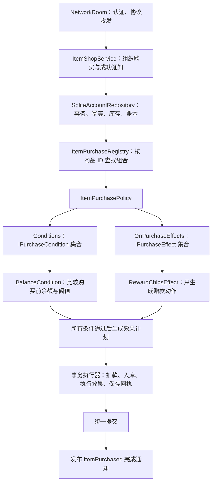

# 契约商品上架与购买行为扩展任务书

## 2026-09-09 更新

三种契约现为消耗品，取消原单种持有上限 1。余额为 0 时仍可免费签约；仓库还款分别扣除 1,100 / 11,000 / 110,000，并消耗一份契约。以下旧阶段中“不可消耗”“只能购买一次”的描述和历史测试结论不再代表当前行为。

实现计划见 [UIPolishAndContractRepaymentPlan.md](UIPolishAndContractRepaymentPlan.md)。

日期：2026-09-07。设计修订：条件与效果独立组合，余额条件使用比较运算符和阈值参数。状态：代码与配置已实施，验证记录见文末。

## 1. 目标与交付范围

在现有物品商城中上架恶魔契约、大恶魔契约、撒旦契约。三者均为免费、不可消耗物品；用户仅能在账户余额恰好为 0 时购买，购买成功立即获得相应筹码，并永久持有该物品。

将商品特有的购买规则从网络处理器和 SQLite 通用交易代码中抽离。通过商品 ID 分别注册购买条件与购买效果，以便后续商品自由组合两者；同时提供购买完成事件，供后续业务订阅。

本轮已按本文件实施代码、配置、协议和测试；本文件保留设计依据与验收标准。

## 2. 实施前仓库事实（历史基线）

| 对象 | 已有内容 | 本任务需要补齐 |
| --- | --- | --- |
| `Assets/Resources/SO/Items/DevilContract.asset` | ID `devil-contract`，名称、图标、说明完整 | 当前 `_kind: 0`，需改为不可消耗 |
| `Assets/Resources/SO/Items/ArchdevilContract.asset` | ID `archdevil-contract`，名称、图标、说明完整 | 当前 `_kind: 0`，需改为不可消耗 |
| `Assets/Resources/SO/Items/SatanContract.asset` | ID `satan-contract`，名称、图标、说明完整 | 当前 `_kind: 0`，需改为不可消耗 |
| `Assets/Prefabs/UI/Panels/ShopPanel/ShopPanel.prefab` | `ItemsView._definitions` 已引用上述三个资产 | 复用已有引用和布局 |
| `Assets/Resources/SO/Shop/ItemServerCatalog.json` | 当前为 `[]` | 添加三个正式报价 |
| `SqliteAccountRepository.Items.cs` | 购买、入库、扣款、账本、幂等回执在同一事务内 | 支持购买条件与正向赠款效果 |
| `ItemShopMessages.cs` / `ItemInventory.cs` | 报价只有 ID、价格、上架状态等基础信息 | 提供奖励、购买条件与拒绝原因的展示数据 |
| `ShopPanel.ItemsOnline.cs` | 已完成请求、重试、权威快照回填 | 展示赠款结果、及时刷新三个商品的可购状态 |

当前枚举为 `ItemKind { Consumable, NonConsumable }`，所以 0 是消耗品、1 才是不可消耗品。实施应以本次用户要求为准修正资产，保持现有 ID 和 `.meta` GUID，不调换枚举顺序。`Docs/ItemShopAndCollection.md` 中关于契约按消耗品配置及尚无服务端协议的描述也需同步更新。

## 3. 产品规则

| 商品 | 稳定 ID | 售价 | 购买成功赠款 | 购买前余额 | 类型 / 持有上限 |
| --- | --- | ---: | ---: | --- | --- |
| 恶魔契约 | `devil-contract` | $0 | $1,000 | 必须等于 $0 | 不可消耗 / 1 |
| 大恶魔契约 | `archdevil-contract` | $0 | $10,000 | 必须等于 $0 | 不可消耗 / 1 |
| 撒旦契约 | `satan-contract` | $0 | $100,000 | 必须等于 $0 | 不可消耗 / 1 |

规则明细：

1. 余额指数据库 `player_accounts.chips`，判断时点是本次事务内、任何扣款和奖励发生之前。客户端余额、UI 按钮状态、缓存的会话余额均不能作为最终依据。
2. 售价保持无符号的 0。赠款是独立购买效果，不使用负价格，不把 `uint Price` 改成有符号字段。
3. 赠款由服务端在购买中立即执行。玩家不用再进入背包点击使用，物品也不被消耗。
4. 沿用现有永久物品规则：每账户每种最多成功购买一次。已有该物品时，即使余额重新变为 0，也不能再次购买或再领其奖励。
5. 本方案不增加三选一、前置契约、升级链、冷却或每日重置规则。余额为 0 且三件均未拥有时，可以任选一件；到账后其他两件因余额非零而不能买。如果以后余额再次回到 0，可以购买另一件尚未拥有的契约。
6. 上述第 4、5 条是沿用现有库存机制的设计口径：三个 ID 分别限购，不共享一次性领取名额。若产品以后希望无限次领取或三选一，需要另行调整规则，不能通过重复发购买事件实现。
7. 延续已有身份认证、当前有效会话、上架状态、报价版本、数量 1、房间外、无活动手牌等限制。客户端只能发出购买请求，不能指定奖励金额或行为类型。
8. 取消确认不产生交易；任意持久化步骤失败时，余额、库存、账户版本、账本和回执全部回滚。

示例：账户余额 0，购买恶魔契约后余额 1,000、恶魔契约数量 1。立即购买大恶魔契约应失败且余额不变；余额再次降到 0 后，可以购买大恶魔契约，但不能再次购买恶魔契约。

## 4. 推荐 OOP 方案：ID 注册表 + 独立条件 + 独立购买效果

条件回答“能不能购买”，效果回答“购买成功会发生什么”。两者独立定义，由商品配置把它们组合起来。零余额条件不需要知道奖励金额；赠款效果也不需要知道零余额条件，普通商品可以单独使用任何一方。

三个契约恰好组合相同的条件和同一类效果，只有奖励参数不同。这是商品配置层的关系，不应固化为一个同时判断余额并赠款的业务类。



### 4.1 职责与依赖边界

| 类型 | 职责 | 不应承担的职责 |
| --- | --- | --- |
| `ItemShopService` | 接收领域购买命令，调用仓储，处理首次提交成功的通知 | 不先读余额再在另一个事务发奖励 |
| `ItemPurchaseRegistry` | 用 `StringComparer.Ordinal` 按 ID 查找不可变的商品购买组合 | 不从客户端输入、反射类型名或任意脚本加载组件 |
| `ItemPurchasePolicy` | 聚合独立的 `Conditions` 和有序的 `OnPurchaseEffects`；启动后冻结 | 不把某种条件与某种效果强制绑定，不增加隐含条件 |
| `IPurchaseCondition` | 读取只读上下文，返回通过或明确拒绝原因，并提供条件描述 | 不改余额/库存，不创建奖励计划，不调用效果 |
| `BalanceCondition` | 按 `ComparisonType` 比较购买前余额与配置阈值 | 不把等于 0 固化为类，不包含奖励或商品类型要求 |
| `IPurchaseEffect` | 为购买阶段生成受控、可执行的效果计划，并提供效果描述 | 不决定商品的购买资格，不自行提交事务，不调用条件 |
| `RewardChipsEffect` | 仅生成指定金额的 `CreditChips` 动作 | 不检查余额必须为 0，不要求商品免费、为契约或不可消耗 |
| `PurchaseContext` | 当前事务读取的账户 ID、购买前余额、目标商品、持有量等必要只读数据 | 不暴露可变账户对象、密码或数据库句柄 |
| `PurchaseEffectCommand` / 事务执行器 | 表达并执行受控状态变动；按顺序检查数值范围、记账、写入同一事务 | 不包含任意委托/SQL，不按商品 ID 分支，不自行打开第二个事务 |
| `SqliteAccountRepository` | 通用校验、检查条件、规划并执行效果、入库、记账、写回执和提交 | 不知道契约 ID，不把赠款与零余额校验写成联合逻辑 |
| `ItemPurchased` / 事件发布器 | 提交成功后的只读通知，按商品 ID 订阅，支持解绑与异常隔离 | 不承担本次赠款或其他必须原子完成的权威写入 |

账户身份、活动手牌、库存上限、支付能力等现有通用约束仍由交易流程统一执行，不能被空条件集合绕过。本期商品条件集合采用 AND：按注册顺序检查，遇到首个不满足条件就返回原因；不引入 OR/NOT 表达式语言或 DI 框架。

条件和效果可以分别为空。没有附加条件和效果的普通商品，注册一个空 `ItemPurchasePolicy` 即可，不再需要特殊的“标准行为”子类。

### 4.2 接口与注册示意

以下为已实现的接口，结果、描述、命令和组合均使用 C# 9 兼容类型：

```csharp
public interface IPurchaseCondition
{
    PurchaseConditionDescriptor Descriptor { get; }
    bool Check(PurchaseContext context);
}

public interface IPurchaseEffect
{
    PurchaseEffectDescriptor Descriptor { get; }
    IReadOnlyList<PurchaseEffectCommand> Plan(PurchaseContext context);
}
```

余额条件使用“判断对象 + 比较方式 + 阈值”的参数化模型：判断对象由 `BalanceCondition` 确定为购买前账户余额，比较方式与阈值由构造参数确定。用户提出的 `BalanceCondition(Type.Equal, 0)` 对应以下命名；使用 `ComparisonType` 明确表示比较枚举。

```csharp
public enum ComparisonType : byte
{
    Equal = 0,
    NotEqual = 1,
    LessThan = 2,
    LessThanOrEqual = 3,
    GreaterThan = 4,
    GreaterThanOrEqual = 5
}

// BalanceCondition 实现 IPurchaseCondition；构造后参数只读。
new BalanceCondition(ComparisonType.Equal, 0);
new BalanceCondition(ComparisonType.LessThan, 1000);
new BalanceCondition(ComparisonType.GreaterThanOrEqual, 10000);
```

`BalanceCondition.Check` 仅将 `context.BalanceBefore` 与只读 `Threshold` 按配置 `Comparison` 比较，返回是否通过；组合返回首个失败条件描述，由通用交易校验映射为 `BalanceConditionNotMet`。阈值类型使用与账户筹码一致的 `uint`；六种比较均直接使用关系运算符，不通过无符号减法判断大小。未知比较枚举必须在构造/加载配置时拒绝，不能自动按相等处理。

条件描述包含条件类型 `Balance`、组件版本、比较方式、阈值；它们共同参与配置版本、资格返回和 UI 文案。对当前契约，配置就是 `Equal, 0`，失败提示仍是“仅余额为 $0 时可购买”，但这个文案由描述格式化，而不是专用条件类或专用协议布尔字段决定。换成 `GreaterThanOrEqual, 1000` 时，同一类即可表达“余额至少为 $1,000”。

`RewardChipsEffect(amount).Plan` 仍只返回一条 `CreditChips(amount)` 命令；金额为正的配置校验在构造/启动阶段完成。执行器检查赠款后的余额范围，这属于状态完整性检查，不给赠款隐含添加任何余额购买条件。

服务端组合入口的目标注册形式：

```csharp
registry.Register("devil-contract", new ItemPurchasePolicy(
    conditions: new IPurchaseCondition[] { new BalanceCondition(ComparisonType.Equal, 0) },
    onPurchaseEffects: new IPurchaseEffect[] { new RewardChipsEffect(1000) }));

registry.Register("archdevil-contract", new ItemPurchasePolicy(
    conditions: new IPurchaseCondition[] { new BalanceCondition(ComparisonType.Equal, 0) },
    onPurchaseEffects: new IPurchaseEffect[] { new RewardChipsEffect(10000) }));

registry.Register("satan-contract", new ItemPurchasePolicy(
    conditions: new IPurchaseCondition[] { new BalanceCondition(ComparisonType.Equal, 0) },
    onPurchaseEffects: new IPurchaseEffect[] { new RewardChipsEffect(100000) }));
```

组合方式应允许以下独立用法（后两类仅用于设计说明和测试，不代表新增正式商品）：

| 附加条件 | 购买效果 | 含义 |
| --- | --- | --- |
| `BalanceCondition(Equal, 0)` | `RewardChipsEffect(1000)` | 当前恶魔契约 |
| `BalanceCondition(Equal, 0)` | 空集合 | 仅限零余额购买，不赠款 |
| 空集合 | `RewardChipsEffect(1000)` | 符合通用购买约束即可赠款，余额不必为 0 |
| 空集合 | 空集合 | 普通购买，只按商品价格扣款并入库 |

条件与效果的描述、版本、参数分别以服务端注册为唯一配置源。展示数据分别从 `PurchaseConditionDescriptor` 和 `PurchaseEffectDescriptor` 投影；商品 JSON 只负责 ID、价格、类型、上架和持有上限。UI 不根据“有奖励”推断“必须零余额”，也不根据“必须零余额”推断“有奖励”。

重复商品 ID、目录商品没有注册组合、空组件、无效参数及未支持的效果描述在启动校验中被发现；运行时计划返回未支持命令则整笔交易拒绝提交；显式空组合与漏注册不是同一情况。三种契约的价格 0、不可消耗、上限 1，以及指定条件/奖励由契约配置验收检查，不能把这些要求写进可复用的 `BalanceCondition` 或 `RewardChipsEffect`。允许通过 `Listed=false` 正常下架。

改变余额比较方式或阈值只修改参数，不新增条件类；新增另一种判断对象的购买条件才实现 `IPurchaseCondition`；新增效果只实现 `IPurchaseEffect`，用已有动作生成计划即可。需要一种全新持久化动作时，再增加该命令和同事务执行支持。组合变化只修改商品注册，网络、UI 和通用交易代码不增加商品 ID 分支。

### 4.3 执行阶段、顺序与事件

统一流程按以下阶段组织，职责独立但交易原子性不拆开：

1. 读取回执；对新交易执行通用约束检查。
2. 在同一购买前快照上检查全部条件。全部通过之前，不规划或执行任何购买效果。
3. 所有效果对相同的只读购买前上下文生成命令；规划阶段不能写库。当前赠款金额来自配置，与余额和条件结果无关。
4. 基础扣款/入库与效果命令在同一事务中执行。效果按配置数组顺序、命令按各自返回顺序执行；执行器在暂存的连续状态上检查每一步余额范围。后一个条件不能读取前一个效果带来的余额，因为所有条件早已完成。效果规划也不依赖另一个效果的副作用。
5. 任一效果规划/执行失败，整个交易不提交；成功则统一提交。
6. 提交后发布 `ItemPurchased` 完成通知。

`OnPurchaseEffects` 就是按商品注册的购买阶段动作。赠款等权威动作由事务执行器执行，虽然业务语义是“购买后获得”，实际对外可见的是“购买、入库、赠款一并成功”。条件对象与动作对象没有相互引用，事务执行器只负责把它们安排在正确阶段。

`ItemPurchased` 则是提交完成的观察事件，供提示、日志、非关键统计使用。可按 ID 订阅，例如 `Subscribe("devil-contract", handler)`；通知携带账户 ID、操作 ID、物品 ID、实际成交金额和效果结果。敏感账户事件仅在服务端内部流转，不广播给其他玩家。

完成事件发布必须位于 `GuardedAccountRepository.Execute` 返回之后。回调异常逐个捕获并记录，不得把已成功交易改报失败、触发存储故障停服或再次执行购买效果。每次服务端启动注册一次，停止时释放订阅，避免重复绑定。

只有 `ItemChangeExecution.IsNewlyApplied == true` 才发布完成事件；回执重放、读取、拒绝和回滚不再次执行效果或发布完成事件。本期内存通知是尽力而为，不能承诺崩溃恢复后必达；权威效果已经在事务内完成，不依赖通知送达。未来若新增必须可靠送达的外部任务，另行采用事务 outbox 和幂等消费者。

## 5. 服务端交易顺序与幂等

以现有 `ChangeItem` 为基础调整，不把整个事务拆成多个独立仓储调用。

1. 网络层验证认证、有效会话、消息形状、序号和频率，使用服务端账户 ID 构造领域命令。
2. 开启 SQLite 写事务；账户检查、效果和写入使用同一连接及事务。不能只依赖单个仓储对象的 `_syncRoot` 处理跨实例竞争。
3. 先按 `(account_id, operation_id)` 查询回执并比对原请求指纹。相同载荷返回原结果和原效果明细，`IsNewlyApplied=false`；不同载荷返回 `InvalidRequest`。
4. 对新操作读取数据库最新账户、持有量和活动手牌状态，校验房间限制、上架、报价版本、数量、永久所有权、持有上限与支付能力。
5. 根据商品 ID 获取 `ItemPurchasePolicy`，以同一购买前事务快照检查全部附加条件。按配置比较运算符和阈值检查 `BalanceCondition`，不满足时返回 `BalanceConditionNotMet` 与失败条件描述；当前三个契约均配置 `Equal, 0`。不修改余额或库存。
6. 条件全部通过后，独立规划 `OnPurchaseEffects`，再由事务执行器按配置顺序执行。当前只有赠款效果时最终余额为 `BalanceBefore - Price + Sum(ChipCredit)`；无赠款效果则奖励总额为 0。采用 `long` 或 `ulong` 中间计算及逐步范围检查，最后转换回 `uint`，避免多效果累加溢出。
7. 在同一事务更新账户余额与版本、增加物品库存、写价格扣款账本和奖励账本、写结果与效果明细回执，然后提交。
8. 提交返回 `ItemChangeExecution`。应用层发布首次成功通知，网络层同步最新账户余额、库存、报价及操作资格。事务结果明细和当前账户快照分开表达，重试不会拿历史余额覆盖最新余额。

**回执必须先于余额为零判断。** 首次成功后余额已大于 0，相同操作重试仍应返回首次成功，不能重新按零余额条件判失败，更不能再次加钱。

`NetworkRoom.Items.cs` 已将内存房间归属传给仓储事务：已认证操作先识别回执，新操作再结合数据库房间/活动手牌状态校验。重试不能绕过身份校验。

同时提交不同契约请求时，如果事务期间没有其他合法余额变动，只有先执行者能够在余额 0 的快照下成功，后续请求看到正余额而拒绝。相同 ID 多个操作同时提交还必须受永久库存约束，不能重复入库。

业务拒绝回执继续保留。某操作曾因非零余额失败，后来余额归零，重放该操作仍返回旧拒绝；用户重新确认购买会生成新的操作 ID。重试不得生成新操作 ID。

## 6. 账本与回执

继续使用真实售价 0，并显式记录奖励来源：

| 记录 | 金额 / 作用 |
| --- | --- |
| `ItemPurchase` | `-Price`；契约为 0，可保留现有零金额购买记录 |
| `ItemPurchaseReward` | `+ChipCredit`；分别为 1,000 / 10,000 / 100,000 |
| `account_items` | 对应 ID 数量变为 1 |
| `item_requests` | 原指纹、原结果、原成交效果明细 |

扣款和效果账本使用不同、确定的唯一 `request_id`，例如基础扣款使用原来的 `item:<account>:<operation>`，效果使用 `item-effect:<account>:<operation>:<effectIndex>:<commandIndex>`。索引取自冻结配置和命令计划的稳定顺序；多个同类型赠款效果也不能共用账本唯一键，每条效果保留来源与实际结果。各条记录的 `balance_before` / `balance_after` 要形成连续的余额变化；最终账户余额与账本汇总一致。不能复用同一账本唯一键，也不能调用会自行另开事务的 `ApplyChipMutation` 来发奖励。

实际使用 schema 8（并行每日任务已使用 schema 7），为 `item_requests` 增加可空 `outcome_json`，保存版本化 `ItemPurchaseOutcome`：物品 ID、实付金额、按顺序保存的实际效果明细（组件标识、版本、参数、实际结果）、条件组合版本、交易前后余额。新接口返回 `Result + Outcome + IsNewlyApplied`，后一标志是本次执行状态，重放时为 false，不从历史成功状态推导。

旧回执保持原结果；没有 `outcome_json` 时返回无效果明细，不用当前奖励配置反推历史奖励。迁移不得补发筹码、赠送物品或改写历史账本。已有契约库存也不因从消耗品改为不可消耗品而自动补发奖励或删除库存；持有数量大于 0 即按已拥有处理。

## 7. 商品配置、协议与 UI

### 7.1 正式目录

任务实现完成后，`ItemServerCatalog.json` 的目标配置为：

```json
[
  { "Id": "devil-contract", "Kind": 1, "Price": 0, "Listed": true, "MaxQuantity": 1 },
  { "Id": "archdevil-contract", "Kind": 1, "Price": 0, "Listed": true, "MaxQuantity": 1 },
  { "Id": "satan-contract", "Kind": 1, "Price": 0, "Listed": true, "MaxQuantity": 1 }
]
```

报价版本必须涵盖完整商品配置、条件集合和有序效果集合：每个组件的标识、版本及参数，按稳定顺序序列化后散列；余额条件的比较运算符和阈值必须纳入其中。增删条件、增删/重排效果或改变奖励金额均应改变版本。仅价格相同不代表报价未变；奖励 1,000 改成 2,000 后，旧确认必须被 `CatalogChanged` 拒绝。注册实例与目录组成不可变的运行配置，不能在执行途中修改金额。

### 7.2 网络和展示数据

请求仍只携带原有商品 ID、数量、报价、目录版本、操作 ID 等字段，不新增客户端奖励参数。

对 `ItemOfferMessage` 和对应 `ItemOffer` 展示模型分别增加效果投影 `RewardChips`、独立条件描述数组 `PurchaseConditions`，以及服务端逐商品给出的可购买状态/原因。余额条件描述使用基础字段表达 `Kind=Balance`、`Comparison`、`Threshold` 和组件版本；不再设置只适用于零余额的布尔字段。一个商品可以配置多个余额条件，全部采用 AND。

无赠款效果时 `RewardChips=0`，无附加条件时 `PurchaseConditions` 为空；两者独立生成，不互相推断。多个赠款效果的展示金额从效果描述安全汇总；读取报价/资格只读取描述并检查条件，不调用 `Plan` 或执行效果。全局 `CanAct` 仍表示连接、房间等全局限制，不应被用来表达某个商品特有条件。

拒绝结果携带失败条件的描述；UI 根据比较运算符和阈值格式化原因。回执保存当时的拒绝原因与条件描述，重放时不从当前配置推算旧拒绝。回复仍补充本次成交效果明细；它与当前快照余额的含义不同。

追加 `BalanceConditionNotMet`、必要的范围拒绝结果等枚举值，不改变已有枚举数值。同步检查服务器投影、Mirror 自动序列化、客户端适配器和 UI 消费端；`Serialization.cs` 中原房间 JSON 不加入库存或奖励私有数据。

UI 验收行为：

- 三件商品始终按上架状态展示。详情明确写出「免费」「仅余额为 $0 时可购买」「购买后获得 $X」「每账户限购一次」，不替换原有图标和设定说明。
- 余额非零且未拥有时按钮禁用，显示「仅余额为 $0 时可购买」；已拥有时显示「已收藏」，收藏页为「永久收藏」。
- 确认框同时展示 $0 价格、实际奖励和零余额限制；取消不改变任何状态。仅在服务器确认成功后显示「获得 $X」，不能用商品配置把旧成功重试伪装成再次到账。
- 第一个契约购买成功后，刷新余额、库存和所有商品资格，其他契约立即变为不可购买；名片页和标题账户余额一并同步。
- UI 不按三个商品 ID 编写判断，只消费服务器投影。展示层可以根据 `PurchaseConditions` 中的比较方式、阈值和当前权威余额立即禁用按钮，最终购买资格仍由服务端事务重新判断。
- 任何账户余额同步（包括名片消费、补助、牌局结束）都应使旧商品资格失效。面板打开且无写请求待确认时重新读取资格；若写请求正在核对，则延后读取，由写结果/后续刷新恢复，不能替换待确认操作。特别覆盖余额从正数回到 0 后的重新启用，不能永久沿用旧的拒绝状态。
- 规则版本、余额或选中商品发生变化时废弃旧确认；继续保留现有关闭面板、断线、重试和旧回复隔离逻辑。

## 8. 实施拆分与文件范围

| 顺序 | 工作包 | 主要位置 | 完成条件 |
| --- | --- | --- | --- |
| 1 | 修正资产分类，明确三种报价 | 三份契约 `.asset`、`ItemServerCatalog.json` | ID/GUID 不变，客户端/服务端均不可消耗、免费、上限 1 |
| 2 | 增加只读上下文、独立条件/效果接口、命令执行器和 ID 注册表 | `Assets/Scripts/Network/Accounts/` | 条件与效果互不依赖，余额条件支持六种参数化比较，支持任一集合为空，注册错误能被检测 |
| 3 | 统一运行配置和报价版本 | `ItemShop.cs`、服务端初始化 | 独立条件和有序效果均参与 revision，组件参数不在多处重复维护 |
| 4 | 改造事务和回执，增加 schema 8 迁移 | `SqliteAccountRepository.Items.cs`、`SqliteAccountRepository.cs`、`GuardedAccountRepository.cs` | 扣款、奖励、库存、账本、回执原子提交；旧回执可重放 |
| 5 | 增加应用服务和成功通知 | `ItemShopService`、`ItemPurchased` 及注册器 | 首次提交成功才通知；异常隔离、解绑明确 |
| 6 | 接通权威资格和结果显示 | `NetworkRoom.Items.cs`、`ItemShopMessages.cs`、`ItemInventory.cs`、`ShopPanel.ItemsOnline.cs`、`ItemBrowserView.cs` | UI 正确显示免费、奖励、条件与状态，保持余额同步 |
| 7 | 领域、数据库、协议、UI 与联机验收 | `Assets/Scripts/Game/Editor/`、集成运行器 | 下述测试通过，正常购买与名片回归通过 |
| 8 | 同步维护文档 | `ItemShopAndCollection.md`、`ItemShopServer.md` | 消除旧消耗品/未接协议描述，记录实际测试和限制 |

商品必须与完整规则一同交付，不能先把售价 0 的商品单独上线，再等待后续事件补发奖励。新脚本使用现有 `Game.Network.Accounts` 等职责命名空间、C# 9、UTF-8 / CRLF，补齐 `.meta`；保留旧文件原编码。无需改变 Unity、Mirror、包版本或全项目持久化架构。

## 9. 验收用例

| 编号 | 场景 | 必须满足的结果 |
| --- | --- | --- |
| A1 | 三种契约，各用余额 0 的独立账户首次购买 | 分别获得 1,000 / 10,000 / 100,000，物品数量 1，账户版本只按一次交易增加 |
| A2 | 余额为 1、999、1,000、100,000、`uint.MaxValue` | 均拒绝契约购买，不能扣款、入库或赠款 |
| A3 | 普通付费/免费商品，没有零余额条件或赠款效果 | 保持原有行为，不被契约限制影响；普通免费商品不赠款 |
| A4 | 余额 0、已拥有目标契约 | 返回已拥有，不发钱；在收藏中不可使用 |
| A5 | 购买一种后直接购买另一种；以后余额重新归零再买另一种 | 第一种到账后阻止第二次；以后满足条件且未拥有时允许另一种 |
| A6 | 同一操作因超时、断线、重启而重试 | 返回原结果与原赠款明细，最新余额单独刷新；不多一份库存、奖励账本或成功通知 |
| A7 | 原操作 ID 改商品、数量或报价；不同账户同操作 ID | 前者拒绝，后者彼此独立 |
| A8 | 同账户并发购买同一契约，或并发购买三个不同契约 | 在没有中间余额变动时只有一次新购买成功；其余按规则拒绝；用独立仓储实例验证 SQLite 事务隔离，不只测 UI 禁用 |
| A9 | 在账户更新、库存写入、价格账本、奖励账本、回执处逐项注入故障 | 整个事务回滚、无成功通知，沿用存储故障处理；尤其不能库存已得但奖励未得 |
| A10 | 提交后响应丢失，随后奖励配置变化 | 用原请求重试仍返原成功/原奖励；全新请求携旧 revision 返回 `CatalogChanged` |
| A11 | 非零余额拒绝后余额归零 | 原操作重试仍为原拒绝；重新确认的新操作可成功 |
| A12 | 未认证、被替换连接、伪造/未知 ID、房间或活动手牌中尝试 | 不获得任何库存或奖励；身份隔离和房间限制不回退 |
| A13 | 已成功后进入房间再重放原请求 | 有效身份下只重放回执，不再次校验为一次新购买、不再次赠款；新购买仍受房间限制 |
| A14 | 改变奖励金额、条件版本、条件集合或效果顺序，价格仍为 0 | revision 变化，旧确认失效；重复商品注册和漏注册无法静默上架 |
| A15 | 成功通知的一个监听器抛异常，或服务停止后重启 | 已提交结果不变，其他监听器可处理；不因异常停存储服务、不积累重复订阅 |
| A16 | UI 取消、重复点击、跨页签、关闭重开、旧回复 | 取消无交易；待确认禁止重复提交；旧确认/回复无效；库存与公共余额一致 |
| A17 | 外部账户余额更新导致正数→0、0→正数 | 三个商品资格及时重新读取；不沿用旧可购状态，不丢失待确认写操作 |
| A18 | schema 7 升级到 8（兼容 schema 6），旧账户、库存和回执已存在 | 不补发奖励、不清库存，旧数据与账本保持；重复 Initialize 可正常运行 |
| A19 | 请求、报价、回复经过 Mirror 实际序列化往返 | 奖励和条件字段完整，私有库存/回执不进入公开房间视图 |
| A20 | 一服至少两端，包含账户归零测试夹具 | 完成契约购买、余额同步、重新登录/重开库存及建房、入房、准备、下注、结算、断线回归；最终账本对账一致 |
| A21 | 只注册零余额条件，购买效果为空 | 零余额可买、正余额拒绝；成功仅按基础价格入库，不自动赠款 |
| A22 | 只注册赠款效果，附加条件为空 | 符合通用约束的正余额账户也能购买并得到配置奖励，不触发零余额拒绝 |
| A23 | 任一条件不满足，或 UI 仅查询可购资格 | 不规划/执行购买效果、不产生奖励；多个条件读取相同购买前快照 |
| A24 | 同商品配置两个赠款效果；后一个执行失败或累计溢出 | 成功时按顺序准确记账；失败时前一个效果、基础扣款、库存和回执一起回滚，不能只保留部分奖励 |
| A25 | 分别增删条件、增删/重排效果；验证展示投影 | revision 正确变化；奖励与零余额提示独立显示，不互相推断或改变另一集合 |
| A26 | 六种 `ComparisonType` 分别覆盖阈值以下、相等、以上 | Equal/NotEqual、严格/包含边界的大于小于语义正确；修改参数即可改变规则，不新增条件类 |
| A27 | 阈值与余额覆盖 0、1、`uint.MaxValue`，配置包含未知比较枚举 | 不发生无符号减法溢出，不通过越界加减构造测试值；未知枚举在配置阶段拒绝 |
| A28 | AND 组合 `BalanceCondition(GreaterThanOrEqual, 100)` 与 `BalanceCondition(LessThan, 1000)` | 余额 100 与 999 满足、99 与 1000 不满足；比较方式/阈值改变后 revision 变化，UI 文案及旧拒绝回执准确 |

归零测试通过独立测试数据库中的合法、可对账筹码变动建立，不改正式账户、不跳过账本直接把余额清零。测试除验证成功后的余额，还要核对每条账本、库存数量、回执重放与事件次数。

## 10. 完成定义与本任务书的核查记录

实施完成应交付可审查的配置与代码、迁移和测试结果，并用 Unity `2022.3.52f1c1` 完成编译、Mirror Weaver、相关 EditMode 与真实一服多端验证。Serialized 字段或 prefab 如有变化，运行 `Game.unity` 检查 Missing Script / Reference 与交互。最终说明实际执行及未执行的验证，不能把现有通用商店的历史通过记录当作本次契约规则已经通过。

代码已落在 PurchaseConditions、ItemPurchasePolicy、ItemPurchaseRuntime、ItemShopService 以及现有 SQLite/协议/UI 适配器中。契约迁移使用 schema 8；其他任务可在其后追加版本。447 项为此前通用商店历史测试，本轮结果另行记录。


## 11. 实际扩展入口

`ContractPurchaseRegistration.CreateRuntime` 是当前组合根：每个商品 ID 必须显式注册 `ItemPurchasePolicy`。未来添加普通商品时，在组合根增加它的注册，并将“免费永久契约”配置校验限定在契约集合内。空条件或空效果均合法；缺失注册、重复 ID、无效参数拒绝启动。运行配置复制商品数据并封装只读集合，不持有可变 authoring 目录。

需要原子改变权威状态的逻辑，添加到 `OnPurchaseEffects`。效果只能返回受控命令；当前事务支持 `CreditChips`，多个命令按顺序记账，返回计划必须与权威效果描述中的金额一致。新增持久化动作时补充命令及事务执行支持。条件与效果实现必须不可变、无副作用；读取商品资格不调用 `Plan`。

提交后观察事件的示例（仅服务端代码调用）：

```csharp
IDisposable subscription = networkRoom.ItemPurchaseEvents.Subscribe("devil-contract", purchased =>
{
    // purchased.AccountId / OperationId / Outcome 为本次已提交购买信息。
    // 在这里做日志等非关键响应。发钱等原子操作应放在购买效果中。
});
// 订阅者销毁时解除绑定；服务器停止也会统一 Clear。
subscription.Dispose();
```

事件按商品 ID 路由。仓储返回后才发布，订阅者异常逐个隔离；读取、拒绝、回滚和回执重放都不发布。该内存通知不承诺进程崩溃后补发。


## 12. 本轮验证记录

- Unity 2022.3.52f1c1 完整脚本编译和 Mirror Weaver 已通过。
- 初始专项作业 `6f6894d141a2411a98615482ad0e3685` 执行 61 项，迁移夹具因重建历史表后复用旧结构缓存连接失败；修复夹具为重新打开数据库后，契约相关用例在全量运行中全部通过。生产迁移无需因此修改。
- 全量作业 `42e9998df16d4744927803a441dcda2b` 执行 567 项，564 通过；3 项失败来自同时开发的每日任务/物品发放测试夹具，已交由对应任务修复。
- 在 `Game.unity` PlayMode 以仅存在内存的展示快照检查 1920×1080：三件免费商品、不可消耗分类、奖励/条件/限购说明、零余额可购买、正余额禁用、完整详情滚动。截图为 `Logs/ContractShop/contract-zero-final.png` 与 `contract-positive-scroll.png`；没有修改正式账户。
- 详情新增 ScrollRect 和 ContentSizeFitter，购买说明置顶，防止原短文本区域截断规则；`Poker/UI/Update Item Detail Scroll` 可对旧面板一次性补齐该结构。

- 最终全量 EditMode 作业 `01900dae7436414496ad3645d1dc402c`：**567/567 通过，0 失败、0 跳过**。覆盖契约、通用物品、UI 导航、账户、名片、任务与牌局回归。
- 最终资源检查：`Game.unity` 场景 0 问题；`ShopPanel` Missing Script/Reference 为 0，滚动说明引用完整；三个契约资产均为 Kind=1 且图标完整。

- Windows 最终开发构建 `build-ece9d259d2` 成功，0 error、4 warning，输出 `Build/ContractShop/Poker.exe`。构建包含本轮新协议、Mirror Weaver 及最新面板资源。
- 2026-09-08，一服三端 `Logs/ContractShop/contracts-6cc3d512` 产生四份 `.pass`；三个账户分别购买正式 `devil-contract` / `archdevil-contract` / `satan-contract`，从零余额分别获得 1,000 / 10,000 / 100,000，每份库存数量 1。每端均完成真实 UI 取消、确认、等待服务器、其他按钮禁用、永久收藏和离房重开检查，六份 `contracts-*-purchase/reopen.checked` 完整。
- 同次联机运行覆盖三手牌局的建房、入房、准备、下注、阶段推进、结算、旁观/参战转换、离开重入与断开。最终 `AccountBalanceTotal=LedgerNetTotal=111000`，活动手牌 0、账户账本差异 0。进程均退出，测试前 HKCU 登录偏好已恢复。
- 只读数据库复核见同目录 `database-audit.json`：三份库存、三笔奖励（0→1,000 / 0→10,000 / 0→100,000）、三份成功购买回执，schema 9。测试仅使用 `PokerIntegration-6cc3d512.db`，未改正式账户。
- 一服三端以 `-batchmode -nographics` 运行，日志中的无图形设备 Shader 提示不用于视觉验收；视觉检查在上面的 Editor PlayMode 中独立完成。本任务未自行构建或运行 Linux/WebGL，Linux 验证由并行任务另行进行，不能视作此处已通过。
- 新增 Assets 脚本均附 `.meta`，C# 使用 CRLF；NetworkRoom 保留 GBK。工作区已有其他任务修改均保留，没有执行提交、回滚或修改生成工程文件。
